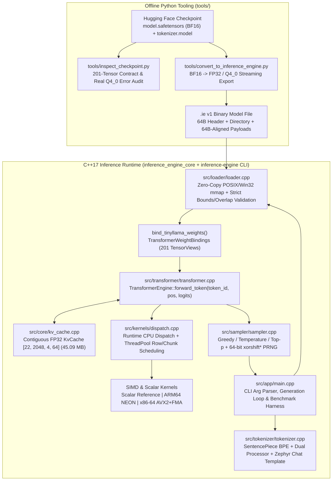

# `00_MASTER_PROJECT_CONTEXT.md` — BIOS V2 PS08 Master Project Context

> **Document Role:** Canonical, self-contained technical orientation for **all four team members (S, U, I, P)** and their AI coding agents (Antigravity, Claude Code, Codex, Cursor).
> **Project Name:** `inference-engine` (`shreyaas5/inference-engine`)
> **Competition Context:** **BIOS V2 — Problem Statement PS08 (Own Inference Engine)**
> **Consolidated Baseline Branch:** `integration-ps08-team-sync-2026-10-31` (`33d4bdc4486e83f458b6a242d9a2fd051503e6ff`)
> **Active Unmerged Remote Feature Branches:**
> - `origin/feature/cpu-kernel-optimisation` (`b05c4e49bf135342e4f94a43a5e4c45763c802e1` — Member I: AVX2 2-row register tiling, vectorized scale accumulation, contiguous 2-row `dispatch.cpp` chunk scheduling, and `inference_engine_bench` suite)
> - `origin/feature/transformer-runtime` (`e64078c84e7832deb0444f51ffad40c45154438d` — Member U: GCC 16 `<cstdint>` fix for SentencePiece `FetchContent` compilation)

---

## 1. Competition Context (BIOS V2 — PS08) & Core Engineering Mandate

**BIOS V2** is a systems-engineering competition. Problem Statement **PS08 ("Own Inference Engine")** challenges a 4-person engineering team to design, implement, verify, and benchmark a standalone Large Language Model (LLM) inference engine from scratch in modern C++17.

### 1.1 What PS08 Requires
1. **Zero External Inference Runtime Dependencies (`VERIFIED`):** Every tensor operation, dequantisation routine, attention kernel, KV cache update, and sampling step at runtime must execute in custom C++17. Linking or invoking PyTorch, LibTorch, TensorFlow, ONNX Runtime, `llama.cpp`, GGML, or Apple MLX at runtime is **strictly forbidden**.
2. **Commodity Laptop CPU Execution Only (`VERIFIED`):** Official inference and benchmarking run exclusively on laptop CPUs across two target architectures:
   - **ARM64 (`aarch64`):** Apple Silicon M-series laptops using ARM NEON (`<arm_neon.h>`) intrinsics.
   - **x86-64 (`AMD64`):** Intel/AMD laptops (verified on AMD Ryzen 7 7745HX, 8C/16T) using AVX2 + FMA (`<immintrin.h>`) intrinsics with runtime `cpuid` + `xgetbv` feature detection.
   - No GPU (CUDA, Metal, Vulkan, OpenCL) or NPU acceleration is permitted.
3. **Custom Binary Model Format (`.ie` v1) (`VERIFIED`):** Pretrained Hugging Face `model.safetensors` weights are converted offline via Python (`tools/convert_to_inference_engine.py`) into a custom, 64-byte-aligned, zero-copy memory-mapped (`.ie`, magic `"IEMF"` / `0x464D4549`, version `1`) file.
4. **Custom 4-Bit Weight Quantisation (`Q4_0`) (`VERIFIED`):** Symmetrical 4-bit block quantisation (`32` weights per `18`-byte block: `2`-byte IEEE 754 FP16 scale `d` + `16` nibble-packed bytes `qs[0..15]`) reduces the 1.1B model footprint from **4.40 GB (`FP32`)** to **619.11 MB (pure `Q4_0`)** or **1.07 GB (mixed `Q4_0` + `FP32` embeddings/head)** while fusing dequantisation directly into SIMD matrix-vector dot products.
5. **Mathematical Transparency & Reproducible Verification (`VERIFIED`):** Scalar reference kernels (`src/kernels/scalar/`) define numerical ground truth. SIMD kernels (`src/kernels/neon/`, `src/kernels/avx2/`), `Q4_0` block packing, `KvCache` state transitions, full transformer layer math, and SentencePiece tokenisation are verified by automated CTest suites (`9/9` passing) and offline Python parity harnesses (`tools/`).

> **CRITICAL NAMING RULE:** Never use `BIOS` as the project name, product name, C++ namespace, folder name, binary name, or file prefix. `BIOS V2` is the competition name only. The project name is `inference-engine`, the C++ namespace is `inference_engine`, the static library is `inference_engine_core`, the CLI binary is `inference-engine`, the test binary is `inference_engine_tests`, and the kernel benchmark binary (on `origin/feature/cpu-kernel-optimisation`) is `inference_engine_bench`.

---

## 2. Evidence Classification System

Every significant technical claim across all handoff documents (`00` through `06`) carries one of the following explicit evidence classifications:

| Classification | Definition |
| :--- | :--- |
| **`VERIFIED`** | Directly inspected in repository source code, build configuration, or Git history and supported by reproducible evidence. |
| **`TESTED`** | Automated unit or integration tests exist in `tests/` or `tools/` and have been executed and passed. |
| **`SYNTHETICALLY VALIDATED`** | Executed and verified end-to-end using deterministic synthetic weights or generated reference fixtures rather than the full 22-layer pretrained checkpoint. |
| **`REAL-CHECKPOINT VALIDATED`** | Tested directly against actual `TinyLlama/TinyLlama-1.1B-Chat-v1.0` assets (`config.json`, `tokenizer.model`, or live `model.safetensors` header/tensors). |
| **`IMPLEMENTED, NOT VERIFIED`** | Source code implementation exists and compiles, but sufficient test coverage or target-hardware verification is not yet recorded. |
| **`PARTIALLY IMPLEMENTED`** | Core structure or subset works, but required sub-features or platform parity remain incomplete. |
| **`NOT IMPLEMENTED`** | Planned or optional capability with no current code implementation. |
| **`BLOCKED`** | Cannot complete until an explicit upstream file, hardware run, or cross-team dependency is satisfied. |
| **`UNKNOWN`** | Insufficient repository evidence to confirm status. |

---

## 3. Target Model Architecture: `TinyLlama-1.1B-Chat-v1.0`

All hyperparameters are frozen in [`include/inference_engine/config.hpp`](../../include/inference_engine/config.hpp) (`TinyLlamaConfig::tinyllama_1_1b()`) and verified against Hugging Face `TinyLlama/TinyLlama-1.1B-Chat-v1.0` (`REAL-CHECKPOINT VALIDATED`):

| Parameter | Frozen Value | Architectural Meaning |
| :--- | :--- | :--- |
| `num_layers` | `22` | Decoder-only Transformer blocks (`model.layers.0` .. `model.layers.21`) |
| `hidden_dim` | `2048` | Residual stream width $D$ |
| `intermediate_dim` | `5632` | SwiGLU MLP hidden dimension $D_{\text{ffn}}$ |
| `num_query_heads` | `32` | Total attention query heads $H_q$ (`32 * 64 = 2048`) |
| `num_kv_heads` | `4` | Grouped-Query Attention (GQA) key/value heads $H_{kv}$ (`4 * 64 = 256`, **8:1 GQA ratio**) |
| `head_dim` | `64` | Per-head dimension $d_k = D / H_q = 64$ |
| `vocab_size` | `32000` | SentencePiece BPE vocabulary size $V$ (`<unk>=0`, `<s>=1`, `</s>=2`) |
| `max_seq_len` | `2048` | Maximum context window $S_{\max}$ |
| `rms_norm_eps` | `1e-5f` | Pre-attention, pre-MLP, and final RMSNorm $\epsilon$ |
| `rope_theta` | `10000.0f` | Rotary Position Embedding base frequency $\theta$ (Llama `rotate_half` convention) |
| Untied Embeddings | `201` tensors total | `model.embed_tokens.weight` and `lm_head.weight` are separate `[32000, 2048]` matrices |

### 3.1 Exact 201-Tensor Inventory & Quantisation Policy (`REAL-CHECKPOINT VALIDATED`)

Every `TinyLlama-1.1B-Chat-v1.0` checkpoint contains exactly **201 tensors** (`1` embedding + `22 * 9 = 198` per-layer tensors + `2` output tensors):

| Tensor Name Pattern | Shape | Elements | `.ie` `--dtype fp32` | `.ie` `--dtype q4_0` | `.ie` `--dtype q4_0 --keep-embeddings-fp32` |
| :--- | :--- | :--- | :--- | :--- | :--- |
| `model.embed_tokens.weight` | `[32000, 2048]` | `65,536,000` | `FP32` (262.14 MB) | `Q4_0` (36.86 MB) | `FP32` (262.14 MB) |
| `model.layers.{i}.input_layernorm.weight` | `[2048]` | `2,048` | `FP32` (8,192 B) | `FP32` (8,192 B) | `FP32` (8,192 B) |
| `model.layers.{i}.self_attn.q_proj.weight` | `[2048, 2048]` | `4,194,304` | `FP32` (16.78 MB) | `Q4_0` (2.36 MB) | `Q4_0` (2.36 MB) |
| `model.layers.{i}.self_attn.k_proj.weight` | `[256, 2048]` | `524,288` | `FP32` (2.10 MB) | `Q4_0` (294.91 KB) | `Q4_0` (294.91 KB) |
| `model.layers.{i}.self_attn.v_proj.weight` | `[256, 2048]` | `524,288` | `FP32` (2.10 MB) | `Q4_0` (294.91 KB) | `Q4_0` (294.91 KB) |
| `model.layers.{i}.self_attn.o_proj.weight` | `[2048, 2048]` | `4,194,304` | `FP32` (16.78 MB) | `Q4_0` (2.36 MB) | `Q4_0` (2.36 MB) |
| `model.layers.{i}.post_attention_layernorm.weight` | `[2048]` | `2,048` | `FP32` (8,192 B) | `FP32` (8,192 B) | `FP32` (8,192 B) |
| `model.layers.{i}.mlp.gate_proj.weight` | `[5632, 2048]` | `11,534,336` | `FP32` (46.14 MB) | `Q4_0` (6.49 MB) | `Q4_0` (6.49 MB) |
| `model.layers.{i}.mlp.up_proj.weight` | `[5632, 2048]` | `11,534,336` | `FP32` (46.14 MB) | `Q4_0` (6.49 MB) | `Q4_0` (6.49 MB) |
| `model.layers.{i}.mlp.down_proj.weight` | `[2048, 5632]` | `11,534,336` | `FP32` (46.14 MB) | `Q4_0` (6.49 MB) | `Q4_0` (6.49 MB) |
| `model.norm.weight` | `[2048]` | `2,048` | `FP32` (8,192 B) | `FP32` (8,192 B) | `FP32` (8,192 B) |
| `lm_head.weight` | `[32000, 2048]` | `65,536,000` | `FP32` (262.14 MB) | `Q4_0` (36.86 MB) | `FP32` (262.14 MB) |

**Exact `.ie` v1 Total File Sizes for 22-Layer TinyLlama-1.1B (`VERIFIED` from live `model.safetensors` header):**
- Header (`64` B) + 201-entry Tensor Directory (`19,660` B) = `19,724` B $\rightarrow$ 64-byte aligned first payload offset = **`19,776` bytes (`0x4D40`)**.
- **Pure `FP32` (`--dtype fp32`):** `4,400,213,312` bytes (**4.40 GB**).
- **Pure `Q4_0` (`--dtype q4_0`):** `619,113,792` bytes (**619.11 MB**, `7.11x` smaller than `FP32`).
- **Mixed `Q4_0` (`--dtype q4_0 --keep-embeddings-fp32`):** `1,069,673,792` bytes (**1.07 GB**, `4.11x` smaller than `FP32`).

---

## 4. Overall System Architecture & Complete Inference Data Flow



### 4.1 Step-by-Step Single-Token Execution Flow (`TransformerEngine::forward_token`) (`VERIFIED`)
For each token `token_id` at 0-based sequence position `pos` (`0 <= pos < max_seq_len`):
1. **Token Embedding Lookup:**
   - If `embed_tokens` is `FP32`: copy row `token_id` (`2048` floats) into residual vector `x_`.
   - If `embed_tokens` is `Q4_0`: dequantise only row `token_id` (`64` `BlockQ4_0` blocks = `1,152` bytes) on-the-fly via `dequantize_row_q4_0` into `x_` (`O(hidden_dim)` work).
2. **For each layer `l = 0 .. num_layers - 1` (`0 .. 21`):**
   - **Pre-Attention RMSNorm:** `scalar::rmsnorm(norm_buf_, x_, layer.input_layernorm, 2048, 1e-5f)`.
   - **Q, K, V Projections:** Routed per-tensor via `project_linear()` (`FP32` $\rightarrow$ `dispatch_matmul_f32`; `Q4_0` $\rightarrow$ `dispatch_matmul_q4_0_f32`) with `backend_` and `&thread_pool_`:
     - `q_buf_` $\leftarrow W_q \cdot \text{norm\_buf\_}$ (`[2048]`)
     - `k_buf_` $\leftarrow W_k \cdot \text{norm\_buf\_}$ (`[256]`)
     - `v_buf_` $\leftarrow W_v \cdot \text{norm\_buf\_}$ (`[256]`)
   - **In-Place RoPE (`rotate_half`):** `scalar::rope_inplace(q_buf_, k_buf_, pos, 32, 4, 64, 10000.0f)`.
   - **KV Cache Write:** `kv_cache_.append(l, pos, k_buf_.data(), v_buf_.data())` — writes `[4, 64]` K and V slices for layer `l` at position `pos` **without** incrementing `kv_cache_.seq_len()`.
   - **Causal GQA Attention (`32` Q heads sharing `4` KV heads, `h_kv = h_q / 8`):** `scalar::attention_gqa(...)` computes scaled dot-product attention ($\text{scale} = 1/\sqrt{64} = 0.125$) over positions `0 .. pos` and writes concatenated head outputs into `attn_out_buf_` (`[2048]`).
   - **Output Projection & Residual Add 1:** `proj_out_buf_` $\leftarrow W_o \cdot \text{attn\_out\_buf\_}$, then `x_ += proj_out_buf_`.
   - **Pre-MLP RMSNorm:** `scalar::rmsnorm(norm_buf_, x_, layer.post_attention_layernorm, 2048, 1e-5f)`.
   - **SwiGLU MLP Projections & Activation:**
     - `gate_buf_` $\leftarrow W_{\text{gate}} \cdot \text{norm\_buf\_}$ (`[5632]`)
     - `up_buf_` $\leftarrow W_{\text{up}} \cdot \text{norm\_buf\_}$ (`[5632]`)
     - `scalar::swiglu(mlp_hidden_buf_, gate_buf_, up_buf_, 5632)` where $\text{SwiGLU}(g, u) = \frac{g}{1 + e^{-g}} \odot u$.
     - `mlp_out_buf_` $\leftarrow W_{\text{down}} \cdot \text{mlp\_hidden\_buf\_}$ (`[2048]`).
   - **Residual Add 2:** `x_ += mlp_out_buf_`.
3. **Final RMSNorm:** `scalar::rmsnorm(norm_buf_, x_, weights_.final_norm, 2048, 1e-5f)`.
4. **LM Head Projection:** `project_linear(weights_.lm_head, norm_buf_.data(), logits_out, 32000, 2048)` — supports both `FP32` and `Q4_0` `lm_head.weight`.
5. **KV Cache Commit:** `kv_cache_.commit_token()` — advances `kv_cache_.seq_len()` to `pos + 1` **once** after all layers succeed.

### 4.2 Autoregressive Prefill & Decode Position Indexing Contract (`VERIFIED`)
For a prompt of $N$ token IDs $(t_0, t_1, \dots, t_{N-1})$:
- **Prefill (`pos = 0 .. N - 1`):** Call `forward_token(t_i, i, logits)` sequentially for $i = 0, \dots, N-1$. Logits from positions $0 \dots N-2$ are overwritten; the logits produced at the final prompt position $N-1$ predict the first generated token $t_N$.
- **Decode (`pos = N, N + 1, ...`):** Sample $t_N \sim \text{Sampler}(\text{logits}_{N-1})$, then call `forward_token(t_N, N, logits)` to predict $t_{N+1}$, stopping on EOS (`</s> = 2`), `--max-new-tokens`, or `pos >= max_seq_len`.

---

## 5. Frozen Binary & Numerical Contracts

### 5.1 `.ie` v1 Model Format (`VERIFIED`)
- **Endianness:** Little-endian throughout; parsed via explicit byte readers (`read_u32_le`, `read_u64_le`, `read_f32_le`), never raw C++ struct casts.
- **64-Byte Header (`0x00 .. 0x3F`, Python struct `"<12I2fQ"`):**
  - `0x00`: `magic = 0x464D4549` (`"IEMF"`), `0x04`: `version = 1`, `0x08`: `tensor_count`, `0x0C`: `weight_dtype` (`0 = FP32`, `2 = Q4_0`).
  - `0x10..0x2C`: `num_layers`, `hidden_dim`, `intermediate_dim`, `num_query_heads`, `num_kv_heads`, `head_dim`, `vocab_size`, `max_seq_len` (eight `u32` fields).
  - `0x30`: `rms_norm_eps` (`f32`), `0x34`: `rope_theta` (`f32`), `0x38`: `total_file_bytes` (`u64`).
- **Tensor Directory & Payload Alignment:** Variable-length directory entries (`name`, `dtype`, `ndim`, `shape`, `payload_offset`, `payload_bytes`). Every `payload_offset` satisfies `payload_offset % 64 == 0` so memory-mapped tensors are 64-byte cache-line aligned for AVX2/NEON loads.

### 5.2 `Q4_0` Block Contract (`VERIFIED`)
- **Struct (`include/inference_engine/quant.hpp`):** `BlockQ4_0 { uint16_t d; uint8_t qs[16]; }` (`sizeof(BlockQ4_0) == 18`, `kQ4_0BlockSize == 32`).
- **Split-Half Nibble Layout (GGML-compatible):**
  - Low nibble `qs[j] & 0x0F` stores quantised weight index `j` (`0 .. 15`).
  - High nibble `(qs[j] >> 4) & 0x0F` stores quantised weight index `j + 16` (`16 .. 31`).
  - Dequantisation: $w_i = (q_i - 8) \times \text{fp16\_to\_fp32}(d)$ where $q_i \in [0, 15]$ and $q_i - 8 \in [-8, +7]$.

### 5.3 CPU Execution Strategy (`VERIFIED`)
- **Runtime Dispatch (`src/kernels/dispatch.cpp`):** `detect_best_backend()` returns `SimdBackend::Neon` on ARM64, `SimdBackend::Avx2` on x86-64 when CPUID + OS XSAVE (`xgetbv`) confirm AVX2 + FMA, and `SimdBackend::Scalar` otherwise.
- **SIMD Optimization (`origin/feature/cpu-kernel-optimisation` at `b05c4e4`):**
  - `avx2::dot_q4_0_f32`: Accumulates unscaled dot products in vector registers (`compute_block_unscaled_dot_vec` + `_mm256_fmadd_ps`) across all blocks in a row, performing a single horizontal reduction (`hsum256_ps`) at the end of the row.
  - `avx2::matmul_q4_0_f32` & `avx2::matmul_f32`: 2-row register tiling (`m` and `m + 1` simultaneously) reuses input activation vector loads `x` across two weight rows, halving activation L1 load pressure.
  - `dispatch.cpp`: Schedules contiguous 2-row-aligned chunks across the persistent `ThreadPool` (`rows_per_task = max(2, ((out_dim + target_tasks - 1) / target_tasks + 1) & ~1)`).
  - **Note on ARM64 NEON:** `src/kernels/neon/kernels_neon.cpp` has working intrinsics (`vld1q_u8`, `vcvt_f32_f16`, `vfmaq_f32`), but still performs per-block horizontal reductions (`vaddvq_f32`) and single-row loops; porting the 2-row tiling and deferred reduction to NEON is an active `P1` task for Member I.

---

## 6. Technology Stack & Build System (`VERIFIED`)

- **Language:** C++17 (`CMAKE_CXX_STANDARD 17`, `CMAKE_CXX_EXTENSIONS OFF`), strict warning flags (`-Wall -Wextra -Wpedantic` on Clang/GCC, `/W4` on MSVC).
- **Build System:** CMake `>= 3.16` (`CMakeLists.txt`). Fetches Google `sentencepiece` (`v0.2.0`) via CMake `FetchContent` as a static library (`sentencepiece-static`) with `CMAKE_POLICY_VERSION_MINIMUM=3.5` for CMake 4.x compatibility.
- **Offline Tooling:** Python 3 (`tools/`) using `numpy`, `safetensors`, `torch`/`transformers` (golden reference generation only), and `sentencepiece`/`protobuf` (tokenizer parity verification only).
- **CI Pipeline (`.github/workflows/ci.yml`):** GitHub Actions matrix across `ubuntu-22.04` (x86-64 AVX2) and `macos-latest` (ARM64 NEON) running build, 9 CTest suites, Python tool self-tests, and C++ vs Python SentencePiece parity verification.

---

## 7. Team Composition, Ownership Boundaries & Git Topology

| Member | Role & Domain | Primary Owned Paths | Active Branches & Latest Commits |
| :--- | :--- | :--- | :--- |
| **S** | Architecture, `.ie` Model System, Conversion Tooling & Integration Lead | `include/inference_engine/{common,config,tensor,loader}.hpp`, `src/common/`, `src/loader/`, `tools/inspect_checkpoint.py`, `tools/convert_to_inference_engine.py`, `tests/test_loader_validation.cpp` | Merged in `33d4bdc`: `origin/feature/model-loader` (`aa40368`), `origin/feature/model-format-q4` (`cb176b3`), `origin/feature/real-checkpoint-validation` (`4515579`) |
| **U** | Transformer Engine, Scalar Reference Kernels, `KvCache` & Golden Verification | `include/inference_engine/{kv_cache,transformer}.hpp`, `src/kernels/scalar/`, `src/core/kv_cache.cpp`, `src/transformer/`, `tools/generate_golden_reference.py`, `tools/verify_transformer_q4.py`, `tests/test_{kernels_scalar,kv_cache,golden_forward,transformer_q4}.cpp` | Merged in `33d4bdc`: `origin/feature/transformer` (`5115467`), `origin/feature/transformer-bindings` (`955bd91`), `origin/feature/transformer-q4` (`ce1026a`). **Unmerged remote:** `origin/feature/transformer-runtime` (`e64078c`) |
| **I** | `Q4_0` Quantisation, SIMD Kernels (NEON/AVX2), `ThreadPool`, Dispatch & Kernel Benchmarks | `include/inference_engine/{quant,thread_pool,kernels}.hpp`, `src/kernels/{quant_q4_0,dispatch}.cpp`, `src/kernels/{neon,avx2,threading}/`, `tests/test_{quant_packing,kernels_simd}.cpp`, `benchmarks/`, `docs/benchmarks/` | Merged in `33d4bdc`: `feature/quantisation-simd` (`f76ab55`), `origin/feature/quantisation-simd-m3` (`58c604d`). **Unmerged remote:** `origin/feature/cpu-kernel-optimisation` (`b05c4e4`) |
| **P** | SentencePiece Tokenizer, Sampler, CLI Runtime, End-to-End Benchmark Harness & CI | `include/inference_engine/{tokenizer,sampler}.hpp`, `src/tokenizer/`, `src/sampler/`, `src/app/main.cpp`, `tools/verify_tokenizer_parity.py`, `tests/test_{tokenizer,sampler}.cpp`, `.github/workflows/ci.yml` | Merged in `33d4bdc`: `origin/feature/runtime-tokenizer` (`ce769c8`) |

### 7.1 Git Branch Hierarchy (`VERIFIED`)
- `main` / `origin/main` (`177fe492eb349ed17a2ffaeda908d92a0d7e0935`): Protected Milestone 1 checkpoint (`M0` + `S` M1 + `U` M1). **Never commit directly to `main`.**
- `integration` / `origin/integration` (`783b8f44e5d2fc2ecf830559139cd19ed8a328fd`): Milestone 2 partial integration (`main` + `I` M2 `f76ab55`).
- `integration-ps08-team-sync-2026-10-31` (`33d4bdc4486e83f458b6a242d9a2fd051503e6ff`): Consolidated 4-member integration baseline containing all M0–M3 work from **S**, **U**, **I**, and **P** (`9/9` CTest suites passing).
- `origin/feature/cpu-kernel-optimisation` (`b05c4e49bf135342e4f94a43a5e4c45763c802e1`): Branched from `5929a17` (parent of `33d4bdc`); contains Member I's AVX2 2-row register tiling, vectorized scale accumulation, `dispatch.cpp` 2-row chunking, `inference_engine_bench`, and Ryzen 7 7745HX benchmark CSVs. Ready for S to selectively merge into the integration baseline.
- `origin/feature/transformer-runtime` (`e64078c84e7832deb0444f51ffad40c45154438d`): Branched from `5929a17`; contains Member U's GCC 16 `<cstdint>` fix for `sentencepiece-static` in `CMakeLists.txt`. Ready for S to cherry-pick/merge into the integration baseline.

---

## 8. Summary of Architectural Decision Records (`ADR-001` through `ADR-012`)

Full text is maintained in [`DECISIONS.md`](../../DECISIONS.md):
- **`ADR-001`:** Target `TinyLlama/TinyLlama-1.1B-Chat-v1.0` with frozen hyperparameters (`22` layers, `32` Q heads, `4` KV heads, `2048` hidden, `5632` intermediate, `32000` vocab).
- **`ADR-002`:** Custom `.ie` v1 binary model format with 64-byte header, variable-length directory, and 64-byte aligned tensor payloads for zero-copy `mmap`.
- **`ADR-003`:** `Q4_0` 4-bit block quantisation (`32` weights / `18` bytes, split-half nibbles) for 2D linear weights while keeping 1D RMSNorm weights in `FP32` and supporting both `FP32` and `Q4_0` for `embed_tokens` / `lm_head`.
- **`ADR-004`:** Explicit `KvCache::append` (per-layer write, never increments `seq_len()`) vs `KvCache::commit_token` (once per completed token after all layers).
- **`ADR-005`:** Strict separation of offline Python tooling (`tools/`) from the zero-dependency C++17 inference runtime (`src/`).
- **`ADR-006`:** 4-branch team ownership model (`S`, `U`, `I`, `P`) with `integration` staging before `main`.
- **`ADR-007`:** Explicit `BF16` $\rightarrow$ `FP32` cast before golden reference generation and `.ie` export to guarantee identical weight precision.
- **`ADR-008`:** Fused dequantisation inside SIMD `dot_q4_0_f32` / `matmul_q4_0_f32` without materialising full-matrix `FP32` weights in RAM.
- **`ADR-009`:** Unified `TransformerWeightBindings` and `bind_tinyllama_weights()` hosted in `loader.hpp` / `loader.cpp`.
- **`ADR-010`:** Dynamic task chunking and `std::exception_ptr` propagation in persistent `ThreadPool`.
- **`ADR-011`:** CMake `FetchContent` integration of `sentencepiece-static` (`v0.2.0`) with dual processors (`processor_` and `processor_no_prefix_`) for exact Hugging Face tokenisation parity.
- **`ADR-012`:** AVX2 2-row register tiling, vectorized per-block scale accumulation (`compute_block_unscaled_dot_vec`), contiguous 2-row-aligned `ThreadPool` chunking, and hardware-prefetcher reliance (no software `_mm_prefetch` penalty).

---

## 9. Repository Directory Structure (`VERIFIED`)

```text
inference-engine/
├── AGENTS.md                        # Mandatory permanent instructions for AI coding agents
├── CURRENT_STATUS.md                # Single source of truth for branch, tests, and active priorities
├── SESSION_HANDOFF.md               # Immediate session-to-session continuation guide
├── PROJECT_CONTEXT.md               # Concise competition & hardware overview
├── DECISIONS.md                     # Architectural Decision Records (ADR-001 .. ADR-012)
├── CMakeLists.txt                   # C++17 build configuration (core lib, CLI, 9 CTest suites)
├── .github/workflows/ci.yml         # Ubuntu x86-64 + macOS ARM64 GitHub Actions pipeline
├── include/inference_engine/        # Public C++17 headers (module boundary contracts)
│   ├── common.hpp                   # Status, StatusCode, DataType, SimdBackend, checked u64 math
│   ├── config.hpp                   # TinyLlamaConfig & ModelFileHeader structs
│   ├── quant.hpp                    # BlockQ4_0 (18B), FP16<->FP32, quantize/dequantize APIs
│   ├── tensor.hpp                   # Non-owning TensorView (data_f32, data_q4_0, row_f32)
│   ├── loader.hpp                   # MmapModelLoader, LayerWeightBindings, TransformerWeightBindings
│   ├── thread_pool.hpp              # Persistent ThreadPool & parallel_for API
│   ├── kernels.hpp                  # Scalar, NEON, AVX2, and runtime dispatch declarations
│   ├── kv_cache.hpp                 # Contiguous FP32 KvCache [layers, max_seq, kv_heads, head_dim]
│   ├── transformer.hpp              # TransformerEngine API
│   ├── tokenizer.hpp                # SentencePiece Tokenizer & ChatMessage API
│   └── sampler.hpp                  # Sampler & SamplingParams API
├── src/                             # C++17 runtime implementation
│   ├── common/status.cpp
│   ├── loader/loader.cpp
│   ├── core/kv_cache.cpp
│   ├── kernels/{quant_q4_0.cpp, dispatch.cpp, scalar/, neon/, avx2/, threading/}
│   ├── transformer/transformer.cpp
│   ├── tokenizer/tokenizer.cpp
│   ├── sampler/sampler.cpp
│   └── app/main.cpp
├── tests/                           # 9 CTest suites + test_main.cpp runner
├── benchmarks/                      # (On origin/feature/cpu-kernel-optimisation) bench_kernels.cpp & CSVs
├── tools/                           # Offline Python scripts (inspect, convert, golden, q4, tokenizer)
└── docs/
    ├── ARCHITECTURE.md, DATA_FLOW.md, FORMAT_SPECIFICATION.md, QUANTISATION.md, BENCHMARKING.md
    ├── context/                     # Living engineering state (TECHNICAL_CONTEXT, IMPLEMENTATION_STATUS, etc.)
    └── team_handoffs/               # This 7-file autonomous team continuation suite (00..06)
```

---

## 10. Current Verified Project Status Summary

| Subsystem | Owner | Status Classification | Verification Evidence |
| :--- | :--- | :--- | :--- |
| `.ie` v1 Loader (`mmap`), Overflow/Overlap Guards & `bind_tinyllama_weights()` | **S** | `VERIFIED` / `TESTED` | `loader_validation` CTest (`6/6` passed) |
| Offline Converter (`FP32`, `Q4_0`, `--keep-embeddings-fp32`) & Live 201-Tensor Inspection | **S** | `REAL-CHECKPOINT VALIDATED` | `convert_to_inference_engine.py --self-test` & `inspect_checkpoint.py --eval-real-quant-error` on `model.safetensors` |
| Full 22-Layer `.ie` Checkpoint Conversion on Disk | **S / All** | `BLOCKED` | Local `models/TinyLlama-1.1B-Chat-v1.0/model.safetensors` is truncated at `325,472,256` / `2,200,120,064` bytes (~14.8%); resume download first |
| Scalar Reference Kernels, `KvCache`, & 16-Step `TransformerEngine` (`FP32`, `Q4_0`, Mixed) | **U** | `VERIFIED` / `SYNTHETICALLY VALIDATED` | `kernels_scalar`, `kv_cache`, `golden_forward`, `transformer_q4` CTests + `verify_transformer_q4.py` (`cos_sim >= 0.996359`) |
| Full 22-Layer Pretrained Checkpoint Forward Pass & Golden Logit Parity | **U** | `BLOCKED` | Blocked only on complete 2.20 GB `model.safetensors` download & `.ie` export |
| `Q4_0` Packing, AVX2+FMA 2-Row Tiling, Vector Scale Accum, `ThreadPool` | **I** | `VERIFIED` / `TESTED` | `quant_packing` & `kernels_simd` CTests + Ryzen 7 7745HX `bench_kernels` (`21.97x` on `2048x2048` 8T, `162.80 GFLOPS` on `2048x5632` 16T in `b05c4e4`) |
| ARM64 NEON Intrinsics (`dot_f32`, `dot_q4_0_f32`, `matmul_*`) | **I** | `PARTIALLY IMPLEMENTED` / `TESTED` | NEON intrinsics pass `kernels_simd` on Apple Silicon (`MaxAbsDiff <= 9.54e-6`), but 2-row register tiling and deferred horizontal reduction from `b05c4e4` are not yet ported to `kernels_neon.cpp` |
| SentencePiece C++ `Tokenizer`, Zephyr Chat Template, `Sampler` & CLI Runtime | **P** | `VERIFIED` / `REAL-CHECKPOINT VALIDATED` (Tokenizer) / `SYNTHETICALLY VALIDATED` (CLI) | `tokenizer` (`4/4`) & `sampler` (`6/6`) CTests + `verify_tokenizer_parity.py --self-test` (`15/15` prompts exact match against real `tokenizer.model`) |

---

## 11. How to Use This Handoff Suite in a Fresh Coding Agent Session

1. **Every team member (`S`, `U`, `I`, `P`) has a dedicated handoff file (`01` through `04`)** containing their exact ownership boundaries, completed work, verified commit SHAs, active dependencies, prioritized remaining tasks (`P0`–`P3`), known issues, and a **ready-to-paste Section G continuation prompt** at the bottom of the file.
2. **To start a new session in Antigravity, Claude Code, Codex, or Cursor:**
   - Open your member handoff document (`01_S_...`, `02_U_...`, `03_I_...`, or `04_P_...`).
   - Copy the prompt block in **Section G ("New-Session Continuation Prompt")** and paste it as your first message to the coding agent.
3. **Cross-module contracts** are frozen in [`05_SHARED_INTERFACES_AND_DEPENDENCIES.md`](05_SHARED_INTERFACES_AND_DEPENDENCIES.md), and project-wide priorities are tracked in [`06_CURRENT_STATUS_AND_NEXT_ACTIONS.md`](06_CURRENT_STATUS_AND_NEXT_ACTIONS.md).
