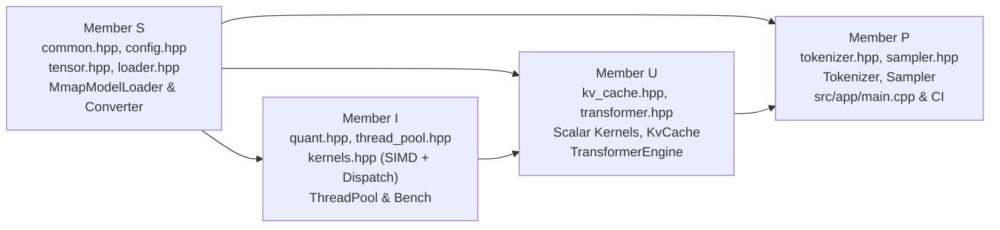

# `05_SHARED_INTERFACES_AND_DEPENDENCIES.md` — Cross-Module Contracts, C++17 Signatures & Dependency Graph

> **Document Role:** Canonical reference for all shared C++17 public headers (`include/inference_engine/*.hpp`), binary layout invariants, memory ownership rules, threading contracts, and cross-team coordination rules.
> **Verification Status:** `VERIFIED` against actual header files in [`include/inference_engine/`](../../include/inference_engine/) on `integration-ps08-team-sync-2026-10-31` (`33d4bdc4486e83f458b6a242d9a2fd051503e6ff`).

---

## 1. Module Ownership & Public Header Map (`VERIFIED`)

| Public Header | Owner | Producers (Implementers) | Consumers (Callers) |
| :--- | :--- | :--- | :--- |
| [`common.hpp`](../../include/inference_engine/common.hpp) | **S** | `src/common/status.cpp` (**S**) | All modules (**S, U, I, P**) |
| [`config.hpp`](../../include/inference_engine/config.hpp) | **S** | Header-only (`TinyLlamaConfig`, `ModelFileHeader`) | `loader.cpp`, `transformer.cpp`, `kv_cache.cpp`, `main.cpp` |
| [`quant.hpp`](../../include/inference_engine/quant.hpp) | **I** | `src/kernels/quant_q4_0.cpp` (**I**) | `tensor.hpp`, `kernels.hpp`, `transformer.cpp`, tests |
| [`tensor.hpp`](../../include/inference_engine/tensor.hpp) | **S** | Header-only (`TensorView`, `TensorMetadata`) | `loader.hpp`, `transformer.cpp`, tests |
| [`loader.hpp`](../../include/inference_engine/loader.hpp) | **S** | `src/loader/loader.cpp` (**S**) | `transformer.hpp`, `main.cpp`, tests |
| [`thread_pool.hpp`](../../include/inference_engine/thread_pool.hpp) | **I** | `src/kernels/threading/thread_pool.cpp` (**I**) | `dispatch.cpp`, `transformer.hpp`, benchmarks |
| [`kernels.hpp`](../../include/inference_engine/kernels.hpp) | **I & U** | `scalar/` (**U**), `quant_q4_0.cpp`, `neon/`, `avx2/`, `dispatch.cpp` (**I**) | `transformer.cpp`, `main.cpp`, tests, benchmarks |
| [`kv_cache.hpp`](../../include/inference_engine/kv_cache.hpp) | **U** | `src/core/kv_cache.cpp` (**U**) | `transformer.hpp`, `transformer.cpp`, tests |
| [`transformer.hpp`](../../include/inference_engine/transformer.hpp) | **U** | `src/transformer/transformer.cpp` (**U**) | `src/app/main.cpp` (**P**), tests |
| [`tokenizer.hpp`](../../include/inference_engine/tokenizer.hpp) | **P** | `src/tokenizer/tokenizer.cpp` (**P**) | `src/app/main.cpp` (**P**), `test_tokenizer.cpp` |
| [`sampler.hpp`](../../include/inference_engine/sampler.hpp) | **P** | `src/sampler/sampler.cpp` (**P**) | `src/app/main.cpp` (**P**), `test_sampler.cpp` |

---

## 2. Exact Shared Enums, Data Structures & C++17 Signatures (`VERIFIED`)

### 2.1 Core Status, DataType & Backend Enums ([`common.hpp`](../../include/inference_engine/common.hpp))
```cpp
namespace inference_engine {

enum class StatusCode : uint32_t {
  Ok = 0,
  InvalidArgument = 1,
  CorruptedFile = 2,
  OutOfBounds = 3,
  UnsupportedFormat = 4,
  IoError = 5,
  NotImplemented = 6,
  InternalError = 7,
};

enum class DataType : uint32_t {
  FP32 = 0,
  FP16 = 1,
  Q4_0 = 2,
  I32  = 3,
};

enum class SimdBackend : uint32_t {
  Auto   = 0,
  Scalar = 1,
  Neon   = 2,
  Avx2   = 3,
};

} // namespace inference_engine
```
> **Important Contract Note:** `DataType::Q4_0` is enum value **`2`** (`FP16 = 1`), matching `DTYPE_Q4_0 = 2` in `tools/convert_to_inference_engine.py` and `tools/inspect_checkpoint.py`.

### 2.2 `Q4_0` Block Layout & Quantisation Functions ([`quant.hpp`](../../include/inference_engine/quant.hpp))
```cpp
constexpr size_t kQ4_0BlockSize = 32;
constexpr size_t kQ4_0BlockBytes = 18;

#pragma pack(push, 1)
struct BlockQ4_0 {
  uint16_t d;       // IEEE 754 FP16 scale factor (2 bytes)
  uint8_t qs[16];   // Low nibble qs[j]&0x0F -> weights 0..15; high nibble (qs[j]>>4)&0x0F -> weights 16..31
};
#pragma pack(pop)
static_assert(sizeof(BlockQ4_0) == kQ4_0BlockBytes, "BlockQ4_0 must be exactly 18 bytes");

float fp16_to_fp32(uint16_t h) noexcept;
uint16_t fp32_to_fp16(float f) noexcept;

Status quantize_row_q4_0(const float* src, BlockQ4_0* dst, size_t n) noexcept;
Status dequantize_row_q4_0(const BlockQ4_0* src, float* dst, size_t n) noexcept;
```

### 2.3 `TensorView`, `MmapModelLoader` & Weight Bindings ([`tensor.hpp`](../../include/inference_engine/tensor.hpp), [`loader.hpp`](../../include/inference_engine/loader.hpp))
```cpp
class TensorView {
 public:
  const void* raw_data() const noexcept;
  const float* data_f32() const noexcept;          // Valid iff dtype() == DataType::FP32
  const BlockQ4_0* data_q4_0() const noexcept;     // Valid iff dtype() == DataType::Q4_0
  const float* row_f32(size_t row_idx) const noexcept;
  DataType dtype() const noexcept;
  const std::vector<uint64_t>& shape() const noexcept;
  uint64_t num_elements() const noexcept;
  uint64_t byte_size() const noexcept;
};

struct LayerWeightBindings {
  TensorView input_layernorm;          // [hidden_dim], always FP32
  TensorView q_proj;                   // [hidden_dim, hidden_dim], FP32 or Q4_0
  TensorView k_proj;                   // [num_kv_heads * head_dim, hidden_dim], FP32 or Q4_0
  TensorView v_proj;                   // [num_kv_heads * head_dim, hidden_dim], FP32 or Q4_0
  TensorView o_proj;                   // [hidden_dim, hidden_dim], FP32 or Q4_0
  TensorView post_attention_layernorm; // [hidden_dim], always FP32
  TensorView gate_proj;                // [intermediate_dim, hidden_dim], FP32 or Q4_0
  TensorView up_proj;                  // [intermediate_dim, hidden_dim], FP32 or Q4_0
  TensorView down_proj;                // [hidden_dim, intermediate_dim], FP32 or Q4_0
};

struct TransformerWeightBindings {
  TensorView embed_tokens;                  // [vocab_size, hidden_dim], FP32 or Q4_0
  std::vector<LayerWeightBindings> layers;  // size == config.num_layers (22)
  TensorView final_norm;                    // [hidden_dim], always FP32
  TensorView lm_head;                       // [vocab_size, hidden_dim], FP32 or Q4_0
};

Status bind_tinyllama_weights(const MmapModelLoader& loader,
                              const TinyLlamaConfig& config,
                              TransformerWeightBindings* out_bindings);
```

### 2.4 Kernel & Dispatch Signatures ([`kernels.hpp`](../../include/inference_engine/kernels.hpp), [`thread_pool.hpp`](../../include/inference_engine/thread_pool.hpp))
> **Parameter Order Rule:** Every matrix-vector and elementwise kernel places the **output pointer `float* out` FIRST**, followed by `weight`, `x`, `out_dim`, `in_dim`.

```cpp
class ThreadPool {
 public:
  explicit ThreadPool(size_t num_threads = 1);
  size_t num_threads() const noexcept;
  void parallel_for(size_t count, const std::function<void(size_t, size_t)>& fn);
};

SimdBackend detect_best_backend() noexcept;
SimdBackend resolve_backend(SimdBackend requested) noexcept;
bool is_backend_available(SimdBackend backend) noexcept;

void dispatch_matmul_f32(float* out, const float* weight, const float* x,
                         size_t out_dim, size_t in_dim,
                         SimdBackend backend,
                         ThreadPool* pool = nullptr) noexcept;

void dispatch_matmul_q4_0_f32(float* out, const BlockQ4_0* weight_blocks, const float* x,
                              size_t out_dim, size_t in_dim,
                              SimdBackend backend,
                              ThreadPool* pool = nullptr) noexcept;
```

### 2.5 `KvCache` & `TransformerEngine` ([`kv_cache.hpp`](../../include/inference_engine/kv_cache.hpp), [`transformer.hpp`](../../include/inference_engine/transformer.hpp))
```cpp
class KvCache {
 public:
  Status init(const TinyLlamaConfig& config);
  void clear() noexcept;
  Status append(uint32_t layer_idx, uint32_t pos, const float* k_data, const float* v_data) noexcept;
  Status commit_token() noexcept;
  Status commit_positions(uint32_t count = 1) noexcept;
  uint32_t seq_len() const noexcept;
  const float* layer_k_ptr(uint32_t layer_idx) const noexcept;
  const float* layer_v_ptr(uint32_t layer_idx) const noexcept;
};

class TransformerEngine {
 public:
  Status init(const TinyLlamaConfig& config,
              const TransformerWeightBindings& weights,
              SimdBackend backend = SimdBackend::Auto,
              size_t num_threads = 1);
  Status forward_token(uint32_t token_id, uint32_t pos, float* logits_out);
  KvCache& kv_cache() noexcept;
  const KvCache& kv_cache() const noexcept;
  SimdBackend active_backend() const noexcept;
};
```

### 2.6 `Tokenizer` & `Sampler` ([`tokenizer.hpp`](../../include/inference_engine/tokenizer.hpp), [`sampler.hpp`](../../include/inference_engine/sampler.hpp))
```cpp
struct ChatMessage {
  std::string role;
  std::string content;
};

class Tokenizer {
 public:
  Status init(const std::string& model_path);
  Status encode(const std::string& text, bool add_bos, bool add_eos,
                std::vector<uint32_t>* out_ids) const;
  Status decode(const std::vector<uint32_t>& ids, std::string* out_text) const;
  Status decode_token(uint32_t id, std::string* out_piece) const;
  static std::string apply_chat_template(const std::vector<ChatMessage>& messages,
                                         bool add_generation_prompt = true);
};

struct SamplingParams {
  float temperature = 0.0f;
  float top_p = 1.0f;
  uint64_t seed = 42ULL;
};

class Sampler {
 public:
  explicit Sampler(const SamplingParams& params = SamplingParams{});
  void reset(const SamplingParams& params) noexcept;
  Status sample(const float* logits, uint32_t vocab_size, uint32_t* out_token_id);
  static uint32_t sample_greedy(const float* logits, uint32_t vocab_size) noexcept;
};
```

---

## 3. Lifetime, Memory Ownership & Threading Contracts (`VERIFIED`)

1. **`MmapModelLoader` Lifetime Rule:**
   - `TensorView` and `TransformerWeightBindings` store raw non-owning pointers into the OS memory-mapped region managed by `MmapModelLoader`.
   - **`MmapModelLoader` MUST outlive `TransformerWeightBindings` and `TransformerEngine`.** Calling `loader.close()` or destroying `MmapModelLoader` immediately invalidates all weight pointers.
2. **Zero-Allocation Hot Loop Rule:**
   - `TransformerEngine::init()` pre-allocates the 45.09 MB `KvCache`, the persistent `ThreadPool`, and all 11 intermediate activation `std::vector<float>` buffers.
   - `TransformerEngine::forward_token()`, `dispatch_matmul_*`, and all SIMD kernels perform **zero dynamic heap allocations** during token generation (`attention_gqa` allocates only a tiny per-token `scores(pos + 1)` buffer).
3. **`ThreadPool` Contract:**
   - If `num_threads <= 1` or `pool == nullptr`, `dispatch_matmul_*` executes synchronously on the calling thread without touching condition variables or mutexes.
   - On `origin/feature/cpu-kernel-optimisation` (`b05c4e4`), `dispatch_matmul_f32` and `dispatch_matmul_q4_0_f32` slice `out_dim` into contiguous 2-row-aligned chunks (`rows_per_task = max(2, ((out_dim + target_tasks - 1) / target_tasks + 1) & ~1)`) and pass `num_tasks` to `pool->parallel_for(num_tasks, ...)` so each worker thread runs the 2-row register-tiled kernel over its contiguous slice `[start_row, start_row + row_count)`.
   - Any exception thrown inside a worker task is captured via `std::exception_ptr` and rethrown on the main thread after all workers complete the batch.

---

## 4. Cross-Module Dependency DAG & Integration Order



### Interface Change Coordination Rule
Any modification to a public header under `include/inference_engine/` that alters an enum value, struct field, or function signature **requires team lead (S) approval** and simultaneous updates to all downstream callers and unit tests before merging into the integration branch.
